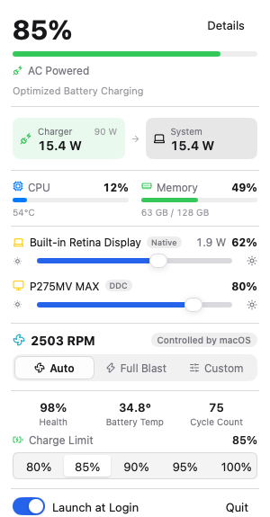
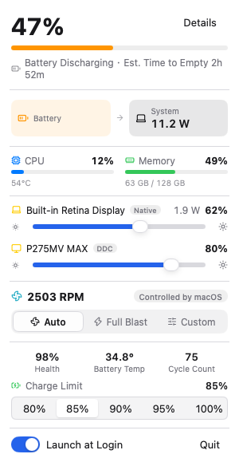
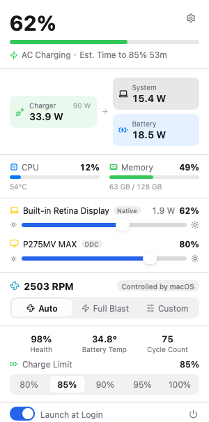
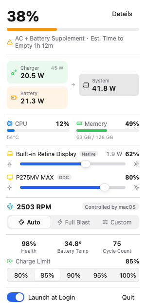
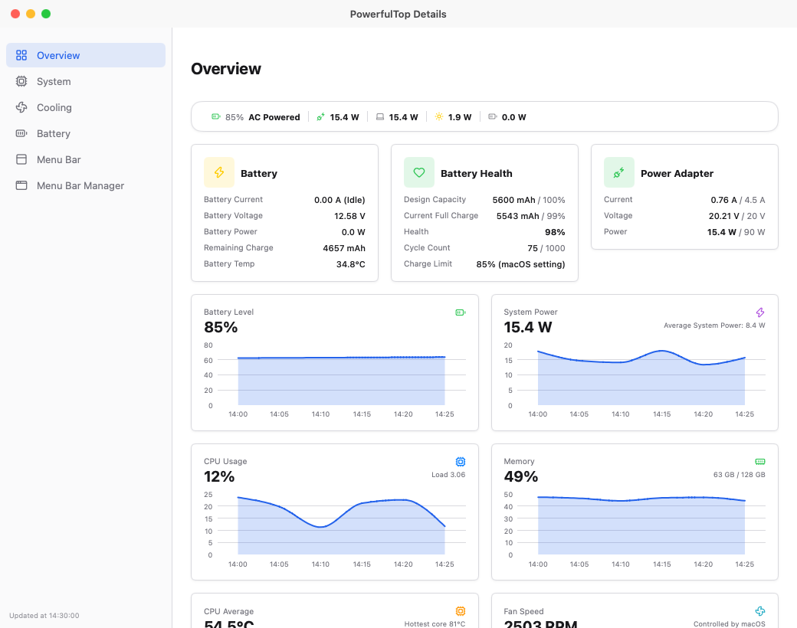
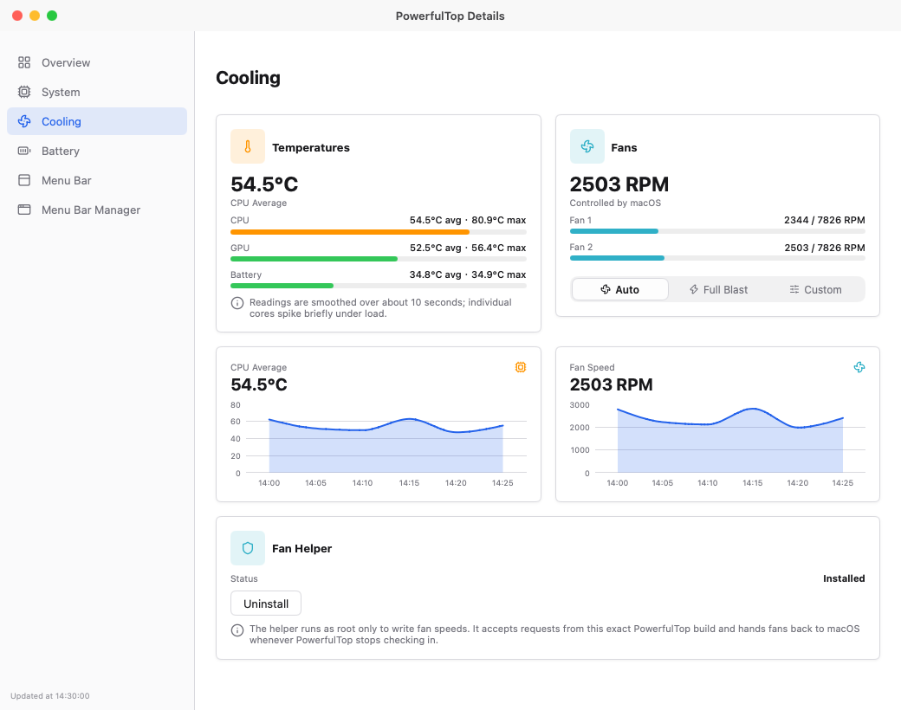
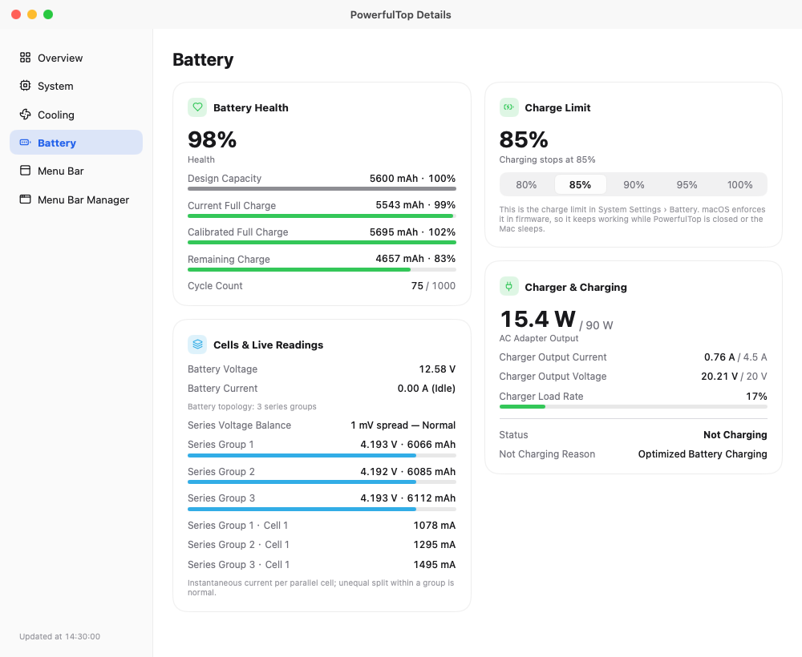
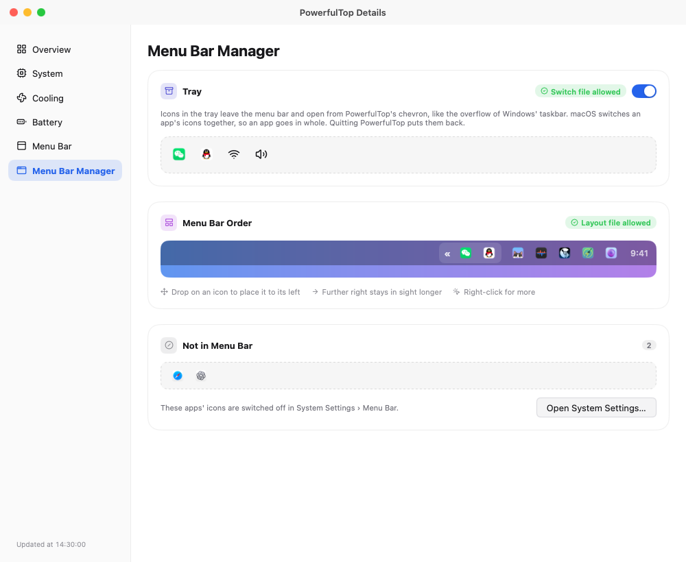

# PowerfulTop

**English** | **[简体中文](README.zh-CN.md)**

> Formerly **PowerTop** — renamed to avoid confusion with Intel's Linux `powertop` tool.

A lightweight menu bar app that shows exactly how much power your MacBook is using — and what the charger, the battery and the fans are doing about it.

<p align="center">
  
  
  
  
</p>

> **MacBook only** — needs a Mac with a built-in battery (Apple Silicon).

## Features

- **Menu bar, your way** — live wattage plus any of 16 readings (percentage, power, temperature, current, CPU, fans, …) in the order you like, with seven icon styles.
- **Popover** — power flow diagram, system, charger and battery watts, time to empty or full, battery level and health, the macOS charge limit, a brightness slider per display, and the fan switch.
- **Overview** — every reading of the last 30 minutes as charts.
- **Battery** — health and capacity, cell topology (e.g. 3S2P) with series voltage and parallel currents, the charger's negotiation, lifetime statistics, and the charge limit itself.
- **Cooling** — CPU, GPU and battery sensors, and fan control: Auto, Full Blast, or a fixed RPM or temperature ramp. One administrator prompt installs the helper, and the fans go back to macOS when PowerfulTop quits, the Mac sleeps, or the chip runs too hot.
- **System** — CPU per core cluster, memory composition, load average, uptime, swap and the busiest processes.
- **Menu bar manager and tray** — every icon in its real order, drag to reorder, and a taskbar-style overflow for the icons macOS tucks behind «.

Everything updates live, including the moment you plug in or unplug the charger.

## Screenshots

### Popover

| **AC Powered** | **Battery Discharging** |
|----------------|--------------------------|
| <a href="screenshot/popover-ac-powered.png" target="_blank"></a> | <a href="screenshot/popover-battery-discharging.png" target="_blank"></a> |

| **AC Charging** | **AC + Battery Supplement** |
|-----------------|------------------------------|
| <a href="screenshot/popover-ac-charging.png" target="_blank"></a> | <a href="screenshot/popover-ac-supplement.png" target="_blank"></a> |

### Details Window

| **Overview** | **Cooling** |
|--------------|-------------|
| <a href="screenshot/detail-overview.png" target="_blank"></a> | <a href="screenshot/detail-cooling.png" target="_blank"></a> |

| **Battery** | **Menu Bar Manager** |
|-------------|----------------------|
| <a href="screenshot/detail-battery.png" target="_blank"></a> | <a href="screenshot/detail-menuBarManager.png" target="_blank"></a> |

## Installation

Download `PowerfulTop-v…-arm64.dmg` from the [Releases](https://github.com/Mieluoxxx/powerfultop/releases) page, open it and drag `PowerfulTop.app` into your `Applications` folder. First launch: right-click the app → **Open** (the app is not signed).

To build it from source, with Go 1.27.3 or later:

```bash
git clone https://github.com/Mieluoxxx/powerfultop.git
cd powerfultop
bash test.sh   # formatting, vet, locales and the unit tests
bash build.sh  # build/PowerfulTop.app
open build/PowerfulTop.app
```

## Requirements

- Apple Silicon MacBook with its built-in battery
- macOS 27 or later

## Acknowledgements

Built with [MyGo](https://github.com/egoist/mygo) and its [CrychicUI](https://github.com/ELY-Open-Source/CrychicUI) components, and inspired by [AlDente](https://apphousekitchen.com), [Macs Fan Control](https://crystalidea.com/macs-fan-control), [Stats](https://github.com/exelban/stats) and [MonitorControl](https://github.com/MonitorControl/MonitorControl). License notices for everything linked in: [THIRD_PARTY_NOTICES.md](THIRD_PARTY_NOTICES.md).

## License

MIT. See [LICENSE](LICENSE).
