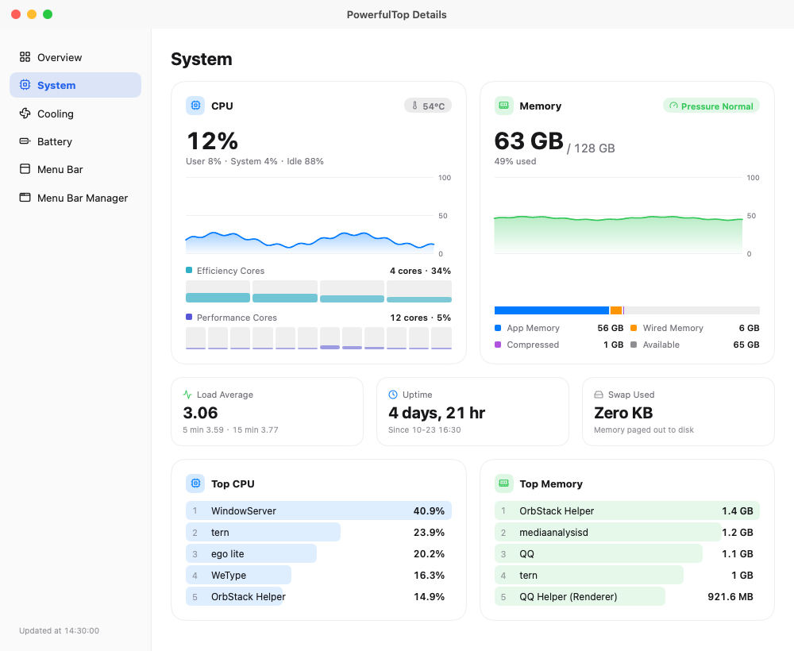
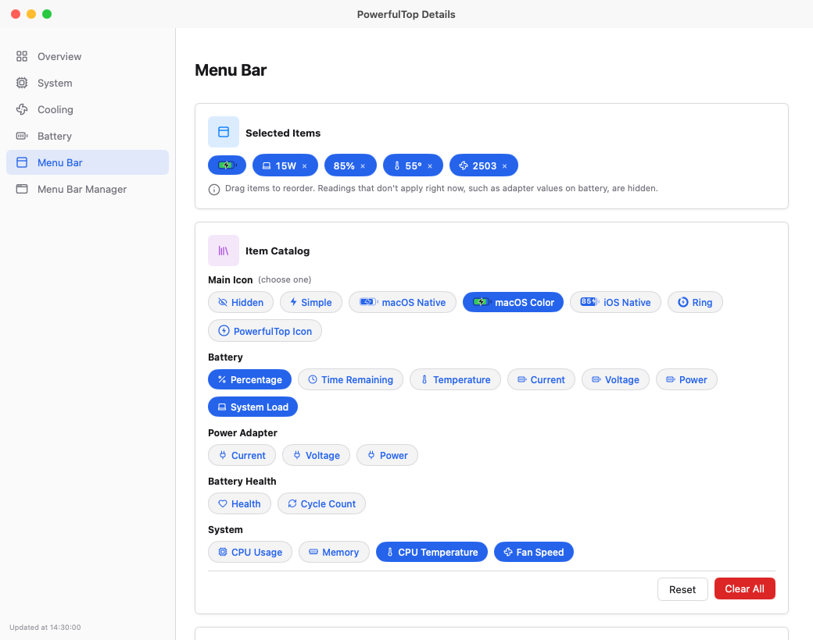

# PowerfulTop

**English** | **[简体中文](README.zh-CN.md)**

> Formerly **PowerTop**. Renamed to avoid confusion with Intel's Linux `powertop` tool.

A clean, lightweight menu bar app that shows you exactly how much power your MacBook is using.

<p align="center">
  
  
  
  
</p>

> **MacBook only** — Requires a Mac with a built-in battery (Apple Silicon MacBook).

## Finally Know How Much Power You're Using

macOS never tells you the actual watts your MacBook is consuming right now. PowerfulTop changes that.

It gives you clear, real-time power information directly in the menu bar and a simple popover — so you can see exactly what's happening with power on your machine.

## Key Features

### In the menu bar

- **Optional menu bar wattage** — Show live power like `23W` right in the menu bar, beside any of the readings below.
- **Your own set of readings** — Percentage, time remaining, temperature, current, voltage, power, health, cycle count, CPU and memory use, CPU temperature or fan speed, in the order you like, with seven icon styles.
- **A menu bar that fits (macOS 27)** — When the menu bar runs out of room, macOS 27 tucks the leftmost icons behind its «. Details › Menu Bar Manager shows every app's icon in its real order, marks what « holds, and reorders them by drag and drop so the ones you need stay in sight; with several displays, pick the one whose menu bar it shows. It needs Accessibility access, and moves icons without the pointer, even those behind «, once you allow the menu bar layout file.
- **Tray (macOS 27)** — Like the overflow of Windows' taskbar: icons you put in the tray leave the menu bar, and PowerfulTop's chevron opens them in a grid; click one for its menu. It uses macOS's own switches under System Settings › Menu Bar, so Focus and the camera and microphone indicators stay, and works for apps and Apple's Control Center items (Wi-Fi, Sound, Display, …). Apps go in whole, since macOS switches an app's icons together. Quitting PowerfulTop puts every icon back. Off by default; turn it on under Details › Menu Bar Manager, and allow the Allow in the Menu Bar list there.

### In the popover

- **Power flow diagram** — See at a glance whether power is coming from the charger, the battery, or both at the same time.
- **Instant power numbers** — System power, charger output, and battery charge or discharge rate.
- **Charger load** — Know your adapter's wattage and how much of it is being used.
- **Screens and brightness** — A slider per display, with the built-in panel's own draw beside it; external monitors are driven over DDC/CI.
- **Fans** — Their speed, who is driving them, and the Auto / Full Blast / Custom switch without opening the window.
- **Battery overview** — Battery level, health, temperature and cycle count, plus the charge limit.
- **Estimated battery time** — Time to empty or full; respects macOS charge limits (80/85/90/95%) and third-party apps like AlDente.

### In the details window

- **Overview** — The last 30 minutes of battery level, system power, CPU, memory, CPU temperature and fan speed as charts.
- **Battery** — Health and capacity, the charge limit, the charger's negotiation, cell topology (e.g. 3S2P) with series-group voltage and parallel cell currents, and lifetime statistics.
- **Cooling** — CPU, GPU and battery sensor groups, the fans' own speeds, and fan control: Auto hands the fans back to macOS, Full Blast pins them, and Custom holds a fixed RPM or ramps with CPU or GPU temperature. Controlling fans needs a small helper that runs as root, installed with one administrator prompt; it hands the fans back to macOS when PowerfulTop quits, the Mac sleeps, or the chip gets too hot.
- **System** — CPU use per cluster, the composition of memory, load average, uptime, swap, and the busiest processes.
- **Settings** — Launch at login, and the battery's own chip, manufacture date and serial number.

## Why People Use PowerfulTop

- Curious about real power consumption on their MacBook
- Want to know if their charger is powerful enough during heavy work
- Like seeing when the battery is helping supply power
- Want a simple, beautiful way to monitor battery health and charging behavior

It's a small, native app that does one thing well — no bloat, no subscriptions. Since 2.0 it is written in Go, with its windows drawn by [MyGo](https://github.com/egoist/mygo)'s native UI from [CrychicUI](https://github.com/ELY-Open-Source/CrychicUI) components.

## Installation

### Download (Recommended)

Download the latest `PowerfulTop-v…-arm64.dmg` from the [Releases](https://github.com/Mieluoxxx/powerfultop/releases) page — each release also publishes a `PowerfulTop.zip` and a checksum file:

1. Open the disk image and drag `PowerfulTop.app` into your `Applications` folder
2. First launch: right-click the app → **Open** (the app is not signed)

### Build from Source

Requires Go 1.27.3 or later (`go` fetches the right toolchain on its own).

```bash
git clone https://github.com/Mieluoxxx/powerfultop.git
cd powerfultop
bash test.sh   # formatting, vet, locales and the unit tests
bash build.sh  # build/PowerfulTop.app and build/PowerfulTop.zip
open build/PowerfulTop.app
```

## Requirements

- Apple Silicon MacBook (M-series), with its built-in battery
- macOS 14 (Sonoma) or later; the menu bar manager and the tray need macOS 27
- Fan control writes the SMC, so it asks for an administrator password once to install its helper

## How to Use

1. Open PowerfulTop — the icon appears in your menu bar.
2. Click the icon for the popover: power flow, current readings, brightness and fans.
3. Choose what the menu bar shows under **Details › Menu Bar**.
4. The details window keeps the depth: charts on **Overview**, the pack on **Battery**, temperatures and fans on **Cooling**, load and processes on **System**.
5. To control fans, install the helper from **Cooling › Fan Helper** once; macOS asks for an administrator password.

## Screenshots

### Popover

| **AC Powered** | **Battery Discharging** |
|----------------|--------------------------|
| <a href="screenshot/popover-ac-powered.png" target="_blank"></a> | <a href="screenshot/popover-battery-discharging.png" target="_blank"></a> |

| **AC Charging** | **AC + Battery Supplement** |
|-----------------|------------------------------|
| <a href="screenshot/popover-ac-charging.png" target="_blank"></a> | <a href="screenshot/popover-ac-supplement.png" target="_blank"></a> |

### Details Window

| **Overview** | **Menu Bar Manager** |
|--------------|----------------------|
| <a href="screenshot/detail-overview.png" target="_blank"></a> | <a href="screenshot/detail-menuBarManager.png" target="_blank"></a> |

| **Battery** | **Cooling** |
|-------------|-------------|
| <a href="screenshot/detail-battery.png" target="_blank"></a> | <a href="screenshot/detail-cooling.png" target="_blank"></a> |

| **System** | **Menu Bar** |
|------------|--------------|
| <a href="screenshot/detail-system.png" target="_blank"></a> | <a href="screenshot/detail-menuBar.png" target="_blank"></a> |

## What's New

### v2.0.0

- **Rewritten in Go** — The app is a Go program now, drawn by [MyGo](https://github.com/egoist/mygo)'s native UI from [CrychicUI](https://github.com/ELY-Open-Source/CrychicUI) components; its settings keep the keys the Swift app used, so an update keeps your menu bar setup.
- **Cooling** — Sensor groups, fan speeds, and fan control: Auto, Full Blast, or Custom with a fixed RPM or a temperature ramp, with a root helper that hands the fans back to macOS when PowerfulTop quits, the Mac sleeps, or the chip gets too hot.
- **System** — CPU use per cluster, memory composition, load average, uptime, swap and the busiest processes.
- **Menu bar manager and tray (macOS 27)** — Every icon in its real order, reorderable by drag and drop, and a taskbar-style overflow that keeps icons reachable while macOS switches them off.
- **Charge limit** — Set the macOS limit (80/85/90/95/100%) on the Battery page or right in the popover.
- **Brightness** — Sliders for the built-in panel and for DDC/CI monitors, next to the built-in panel's own power draw.
- **Charts** — The last 30 minutes of every reading, drawn as the library's area charts on Overview and Cooling.

[Older releases →](https://github.com/Mieluoxxx/powerfultop/releases)

## Acknowledgements

PowerfulTop builds on the work of these projects:

- [CrychicUI](https://github.com/ELY-Open-Source/CrychicUI) — the component library the views are built from (MIT)
- [MonitorControl](https://github.com/MonitorControl/MonitorControl) — display brightness over DisplayServices and DDC/CI (MIT)
- [macos-smc-fan](https://github.com/agoodkind/macos-smc-fan) — the `Ftst` unlock research behind manual fan control on Apple silicon (MIT)
- [Stats](https://github.com/exelban/stats) — inspiration for the CPU and memory monitoring page (MIT)
- [AlDente](https://apphousekitchen.com) — inspiration for the customizable menu bar and the power flow view
- [Macs Fan Control](https://crystalidea.com/macs-fan-control) — inspiration for the fan control modes
- [m1ddc](https://github.com/waydabber/m1ddc) — reference for DDC/CI checksums

## License

MIT License. See [LICENSE](LICENSE) for details. Third-party license notices are in [THIRD_PARTY_NOTICES.md](THIRD_PARTY_NOTICES.md).
