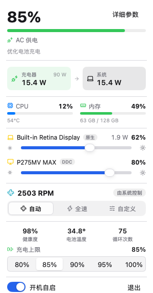
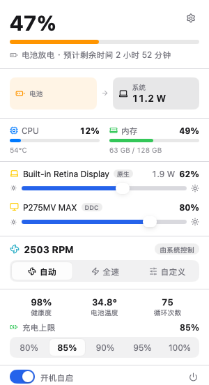
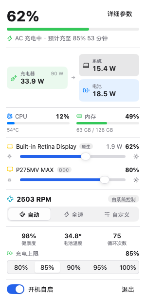
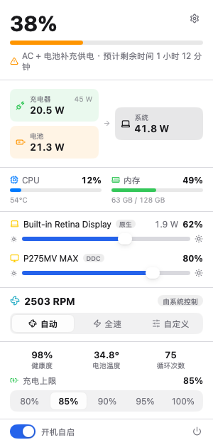
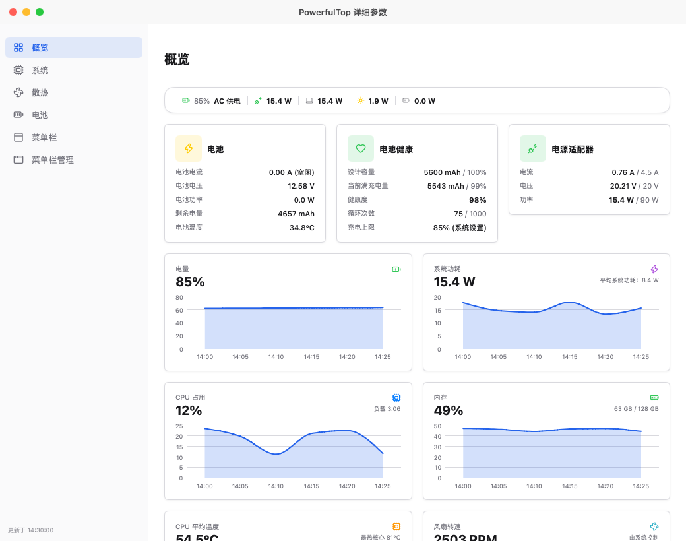
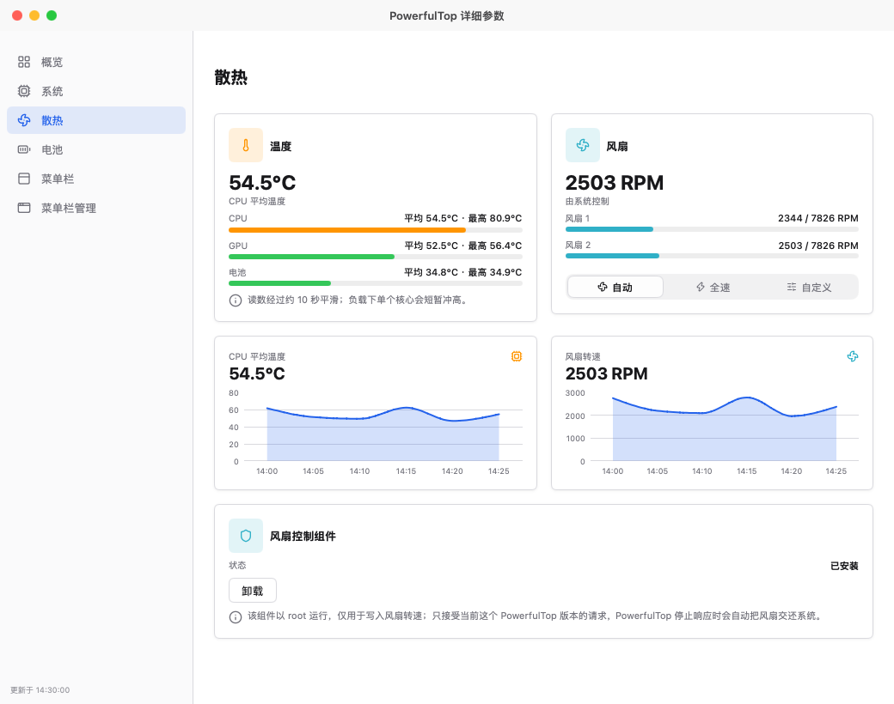
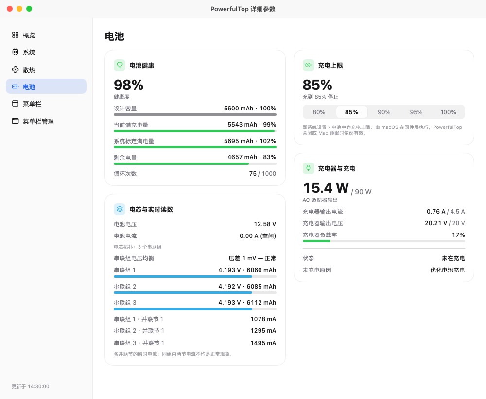

# PowerfulTop

**[English](README.md)** | **简体中文**

> 原名 **PowerTop** —— 为避免与 Intel 的 Linux 工具 `powertop` 混淆而更名。

一个轻量的菜单栏应用，告诉你 MacBook 此刻到底在消耗多少瓦 —— 以及充电器、电池和风扇各自在做什么。

<p align="center">
  
  
  
  
</p>

> **仅限 MacBook** —— 需要带内置电池的 Apple 芯片 Mac。

## 主要功能

- **自定义菜单栏** —— 实时功率，加上 16 项读数（百分比、功率、温度、电流、CPU、风扇……）任你挑选与排序，七种图标样式。
- **弹出窗口** —— 功率流向图、系统 / 充电器 / 电池功率、预计剩余或充满时间、电量与健康度、系统充电上限、每块显示器的亮度滑杆，以及风扇切换。
- **概览** —— 最近 30 分钟每一项读数的曲线。
- **电池** —— 健康度与容量、电芯拓扑（如 3S2P）与串联组电压、并联节电流、充电器协商参数、生命周期统计，以及充电上限本身。
- **散热** —— CPU、GPU、电池三组传感器，风扇控制可选择自动、全速，或固定转速 / 按温度提速。安装小组件只需一次管理员授权；PowerfulTop 退出、Mac 睡眠或芯片过热时，风扇会自动交还系统。
- **系统** —— 各核心簇的 CPU 占用、内存构成、平均负载、已运行时间、交换区与最忙的进程。
- **菜单栏管理与托盘（macOS 27）** —— 按真实顺序列出所有图标、拖放排序，以及类似任务栏溢出区的托盘，收在 « 里的图标也能打开。

数据实时更新，插拔电源的瞬间同样准确。

## 截图展示

### 弹出窗口

| **AC 供电** | **电池放电** |
|-------------|---------------|
| <a href="screenshot/zh/popover-ac-powered.png" target="_blank"></a> | <a href="screenshot/zh/popover-battery-discharging.png" target="_blank"></a> |

| **AC 充电中** | **AC + 电池补充供电** |
|---------------|------------------------|
| <a href="screenshot/zh/popover-ac-charging.png" target="_blank"></a> | <a href="screenshot/zh/popover-ac-supplement.png" target="_blank"></a> |

### 详细参数窗口

| **概览** | **散热** |
|----------|----------|
| <a href="screenshot/zh/detail-overview.png" target="_blank"></a> | <a href="screenshot/zh/detail-cooling.png" target="_blank"></a> |

| **电池** | **菜单栏管理** |
|----------|----------------|
| <a href="screenshot/zh/detail-battery.png" target="_blank"></a> | <a href="screenshot/zh/detail-menuBarManager.png" target="_blank"></a> |

## 安装方式

从 [Releases](https://github.com/Mieluoxxx/powerfultop/releases) 页面下载 `PowerfulTop-v…-arm64.dmg`，打开后把 `PowerfulTop.app` 拖进「应用程序」文件夹。首次启动：右键点击应用 → **打开**（应用未签名）。

也可以从源码构建，需要 Go 1.27.3 或更高版本：

```bash
git clone https://github.com/Mieluoxxx/powerfultop.git
cd powerfultop
bash test.sh   # 格式、vet、多语言与单元测试
bash build.sh  # 生成 build/PowerfulTop.app
open build/PowerfulTop.app
```

## 系统要求

- 带内置电池的 Apple Silicon MacBook
- macOS 14（Sonoma）或更高版本；菜单栏管理与托盘需要 macOS 27

## 致谢

基于 [MyGo](https://github.com/egoist/mygo) 与它的 [CrychicUI](https://github.com/ELY-Open-Source/CrychicUI) 组件构建，灵感来自 [AlDente](https://apphousekitchen.com)、[Macs Fan Control](https://crystalidea.com/macs-fan-control)、[Stats](https://github.com/exelban/stats) 与 [MonitorControl](https://github.com/MonitorControl/MonitorControl)。所引用项目的许可声明见 [THIRD_PARTY_NOTICES.md](THIRD_PARTY_NOTICES.md)。

## 许可证

MIT，详见 [LICENSE](LICENSE)。
