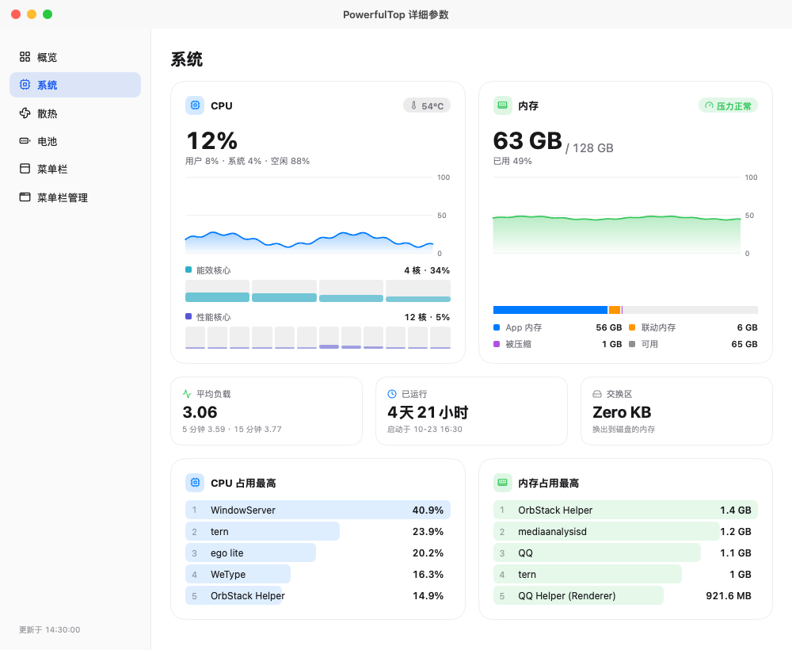
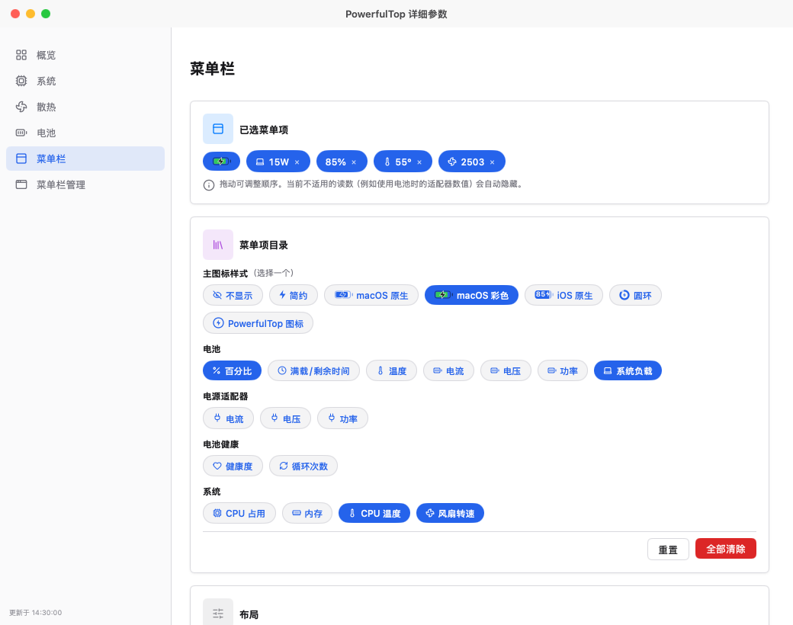

# PowerfulTop

**[English](README.md)** | **简体中文**

> 原名 **PowerTop**。为避免与 Intel 的 Linux 工具 `powertop` 混淆而更名。

一个简洁轻量的菜单栏应用，实时显示你的 MacBook 正在消耗多少功率。

<p align="center">
  
  
  
  
</p>

> **仅支持 MacBook** — 需要配备内置电池的 Apple Silicon MacBook。

## 终于能看到 MacBook 真实的功耗了

macOS 从来不会直接告诉你「现在系统正在消耗多少瓦」。PowerfulTop 解决了这个问题。

它把清晰、实时的功率信息放在菜单栏和弹窗里，让你随时知道电脑的用电情况。

## 主要功能

### 菜单栏

- **菜单栏功率显示（可选）** — 需要时可在菜单栏直接看到 `23W` 这样的实时数字，也可以和其他读数并排显示。
- **自选读数** — 电量百分比、剩余时间、温度、电流、电压、功率、健康度、循环次数、CPU 与内存占用、CPU 温度、风扇转速，顺序随你排，图标有七种样式。
- **放得下的菜单栏（macOS 27）** — 菜单栏放不下时，macOS 27 会把最左边的图标收进 «。在「详细参数 › 菜单栏管理」中可以按真实顺序看到所有 app 的图标，标出被 « 收起的部分，拖放即可调整顺序，让常用的图标一直显示；接了多块显示器时，可以选择看哪一块屏幕的菜单栏。需要辅助功能权限；授权菜单栏布局文件后，移动图标无需移动鼠标，收在 « 里的图标也能移动。
- **托盘（macOS 27）** — 类似 Windows 任务栏的溢出区：放进托盘的图标会离开菜单栏，点 PowerfulTop 的箭头图标就能在网格里看到它们，点一下即可打开菜单。它使用「系统设置 › 菜单栏」里 macOS 自带的开关，因此专注模式和摄像头、麦克风指示器都不受影响；支持第三方 app，也支持控制中心的系统图标（Wi-Fi、声音、显示器等）。macOS 按 app 开关图标，所以同一个 app 的图标会一起收起。退出 PowerfulTop 时所有图标都会回到菜单栏。默认关闭，可在「详细参数 › 菜单栏管理」中开启，并在那里授权「允许在菜单栏中显示」列表。

### 弹出窗口

- **功率流向图** — 一目了然地看到功率是来自充电器、电池，还是两者同时提供。
- **即时功率数据** — 系统功耗、充电器输出、电池充电或放电功率。
- **充电器负载情况** — 显示你的适配器功率以及当前使用率。
- **屏幕与亮度** — 每块显示器一个滑杆，旁边是内建屏幕自身的功耗；外接显示器通过 DDC/CI 调节。
- **风扇** — 转速、当前由谁控制，以及不打开窗口就能用的「自动 / 全速 / 自定义」切换。
- **电池概览** — 电量、健康度、温度、循环次数，以及充电上限。
- **预估剩余时间** — 预计充满或耗尽的时间；支持 macOS 充电上限（80/85/90/95%）及 AlDente 等第三方工具。

### 详细参数窗口

- **概览** — 最近 30 分钟的电量、系统功耗、CPU、内存、CPU 温度与风扇转速曲线。
- **电池** — 健康度与容量、充电上限、充电器的协商参数、电芯拓扑（如 3S2P）与串联组电压、并联节电流，以及生命周期统计。
- **散热** — CPU、GPU、电池三组传感器，风扇转速，以及风扇控制：自动交还 macOS，全速锁住，自定义则固定转速或按 CPU、GPU 温度提速。控制风扇需要安装一个以 root 运行的小组件，macOS 会请求一次管理员密码；PowerfulTop 退出、Mac 睡眠或芯片过热时，风扇会自动交还系统。
- **系统** — 各核心簇的 CPU 占用、内存构成、平均负载、已运行时间、交换区，以及最忙的进程。
- **设置** — 开机启动，以及电池的管理芯片、制造日期与序列号。

## 为什么用户喜欢用它

- 想知道 MacBook 实际消耗了多少功率
- 想了解自己的充电器在高负载时是否够用
- 想看到电池什么时候在帮忙供电
- 希望有一个简单漂亮的方式查看电池健康和充电行为

它是一个小巧的原生 Mac 应用，只做好一件事 —— 没有多余功能，没有订阅。自 2.0 起改用 Go 编写，窗口界面由 [MyGo](https://github.com/egoist/mygo) 的原生 UI 配合 [CrychicUI](https://github.com/ELY-Open-Source/CrychicUI) 组件绘制。

## 安装方式

### 下载安装（推荐）

从 [Releases](https://github.com/Mieluoxxx/powerfultop/releases) 页面下载最新的 `PowerfulTop-v…-arm64.dmg` —— 每个版本同时提供 `PowerfulTop.zip` 与校验文件：

1. 打开磁盘映像，把 `PowerfulTop.app` 拖到「应用程序」文件夹
2. 首次启动：右键点击应用 → **打开**（应用未签名）

### 从源码构建

需要 Go 1.27.3 或更高版本（`go` 会自动下载所需的工具链）。

```bash
git clone https://github.com/Mieluoxxx/powerfultop.git
cd powerfultop
bash test.sh   # 格式、vet、多语言与单元测试
bash build.sh  # 生成 build/PowerfulTop.app 与 build/PowerfulTop.zip
open build/PowerfulTop.app
```

## 系统要求

- Apple Silicon MacBook（M 系列芯片），且带有内置电池
- macOS 14（Sonoma）或更高版本；菜单栏管理与托盘需要 macOS 27
- 风扇控制要写入 SMC，安装其小组件时会请求一次管理员密码

## 使用方法

1. 打开 PowerfulTop，图标会出现在菜单栏。
2. 点击图标打开弹出窗口：功率流向、当前读数、屏幕亮度与风扇。
3. 在「详细参数 › 菜单栏」中选择菜单栏显示的内容。
4. 详细参数窗口提供更深的层次：**概览**看曲线，**电池**看电池组，**散热**看温度与风扇，**系统**看负载与进程。
5. 想控制风扇，先在「散热 › 风扇控制组件」安装一次，macOS 会请求管理员密码。

## 截图展示

### 弹出窗口

| **AC 供电** | **电池放电** |
|-------------|---------------|
| <a href="screenshot/zh/popover-ac-powered.png" target="_blank"></a> | <a href="screenshot/zh/popover-battery-discharging.png" target="_blank"></a> |

| **AC 充电中** | **AC + 电池补充供电** |
|---------------|------------------------|
| <a href="screenshot/zh/popover-ac-charging.png" target="_blank"></a> | <a href="screenshot/zh/popover-ac-supplement.png" target="_blank"></a> |

### 详细参数窗口

| **概览** | **菜单栏管理** |
|----------|----------------|
| <a href="screenshot/zh/detail-overview.png" target="_blank"></a> | <a href="screenshot/zh/detail-menuBarManager.png" target="_blank"></a> |

| **电池** | **散热** |
|----------|----------|
| <a href="screenshot/zh/detail-battery.png" target="_blank"></a> | <a href="screenshot/zh/detail-cooling.png" target="_blank"></a> |

| **系统** | **菜单栏** |
|----------|------------|
| <a href="screenshot/zh/detail-system.png" target="_blank"></a> | <a href="screenshot/zh/detail-menuBar.png" target="_blank"></a> |

## 更新内容

### v2.0.0

- **改用 Go 重写** — 现在是一个 Go 程序，由 [MyGo](https://github.com/egoist/mygo) 的原生 UI 配合 [CrychicUI](https://github.com/ELY-Open-Source/CrychicUI) 组件绘制；设置沿用 Swift 版的键，升级后菜单栏配置照旧。
- **散热页** — 三组传感器、风扇转速，以及风扇控制：自动、全速，或自定义固定转速 / 按温度提速；以 root 运行的小组件会在 PowerfulTop 退出、Mac 睡眠或芯片过热时把风扇交还系统。
- **系统页** — 各核心簇的 CPU 占用、内存构成、平均负载、已运行时间、交换区与最忙的进程。
- **菜单栏管理与托盘（macOS 27）** — 按真实顺序列出所有图标、拖放排序，以及类似任务栏溢出区的托盘，在 macOS 关闭图标时仍能打开它们。
- **充电上限** — 在电池页或直接在弹出窗口里设置 macOS 的充电上限（80/85/90/95/100%）。
- **亮度** — 内建屏幕与外接 DDC/CI 显示器的亮度滑杆，旁边显示内建屏幕功耗。
- **曲线** — 概览与散热页用组件库的面积图画最近 30 分钟的每一项读数。

[更早版本 →](https://github.com/Mieluoxxx/powerfultop/releases)

## 致谢

PowerfulTop 借鉴了以下项目：

- [CrychicUI](https://github.com/ELY-Open-Source/CrychicUI) — 界面所用的组件库（MIT）
- [MonitorControl](https://github.com/MonitorControl/MonitorControl) — 通过 DisplayServices 和 DDC/CI 调节显示器亮度（MIT）
- [macos-smc-fan](https://github.com/agoodkind/macos-smc-fan) — Apple 芯片手动控制风扇所依据的 `Ftst` 解锁研究（MIT）
- [Stats](https://github.com/exelban/stats) — CPU 和内存监控页面的设计参考（MIT）
- [AlDente](https://apphousekitchen.com) — 自定义菜单栏和能量流向视图的设计参考
- [Macs Fan Control](https://crystalidea.com/macs-fan-control) — 风扇控制模式的设计参考
- [m1ddc](https://github.com/waydabber/m1ddc) — DDC/CI 校验和的对照参考

## 许可证

MIT 许可证。详见 [LICENSE](LICENSE)。第三方许可证声明见 [THIRD_PARTY_NOTICES.md](THIRD_PARTY_NOTICES.md)。
